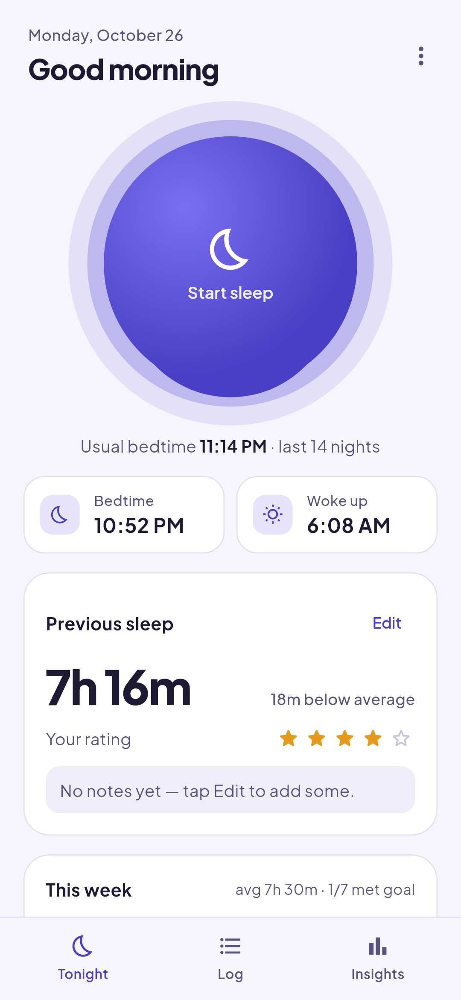
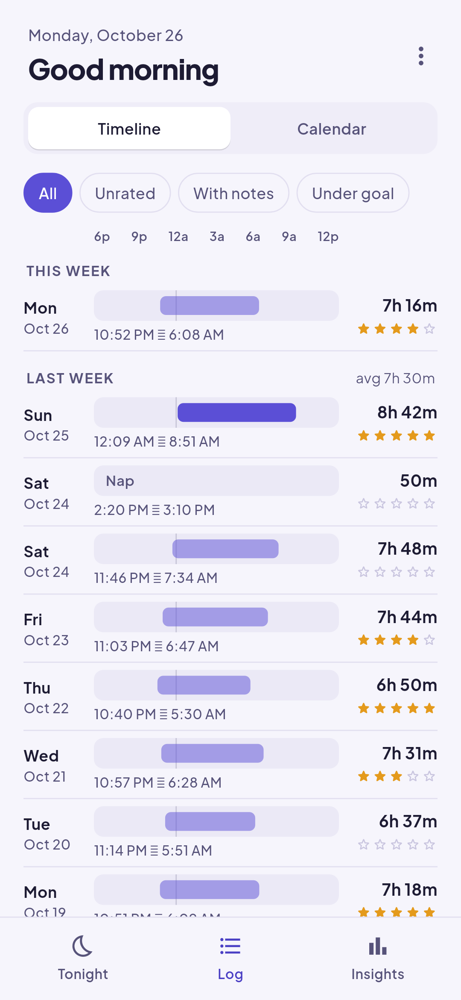
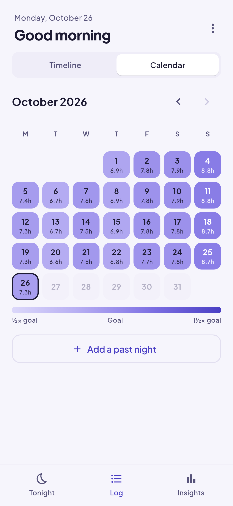
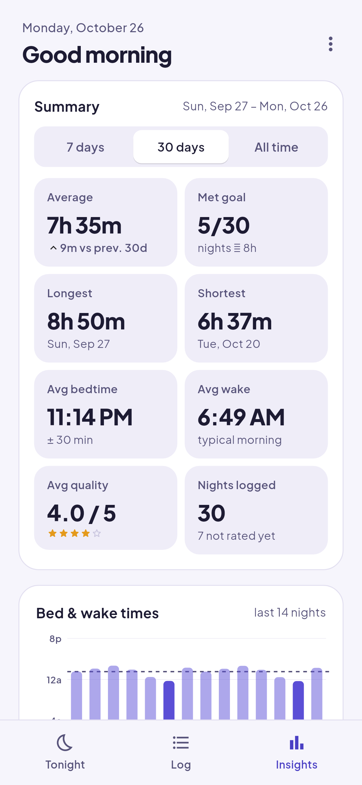
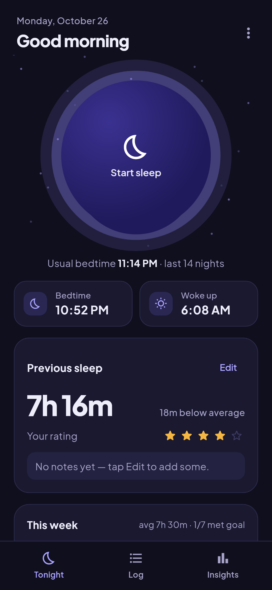
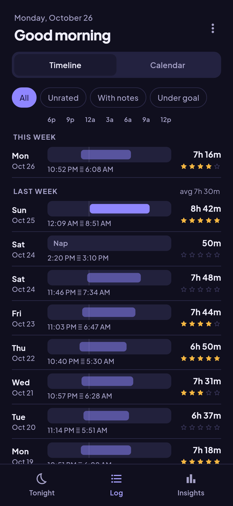
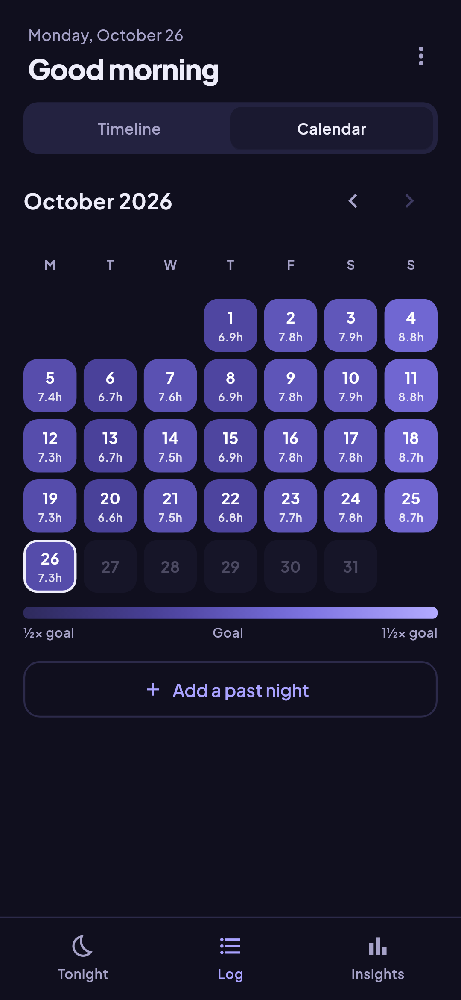
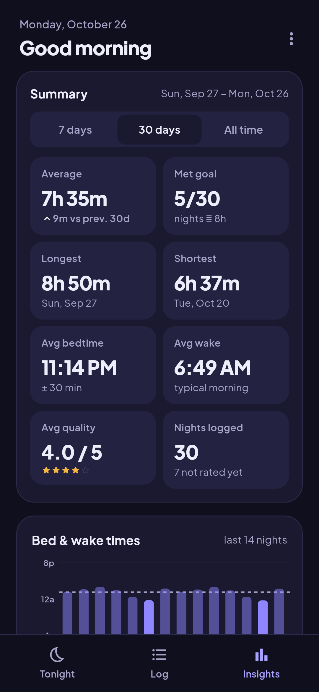

# Sleep Tracker

Tap the moon when you go to bed and again when you wake up. Sleep Tracker keeps the times, works out your usual bedtime and shows how your week went. There's no account and no sync: your sleep lives in a database on your phone that you can back up to a file.

<p>
  
  
  
  
</p>

<p>
  
  
  
  
</p>

## Features

- **One tap** to start and stop a sleep, from the app or from a Quick Settings tile that shows how long you've been asleep
- **Tonight**: your usual bedtime, your previous sleep and the past 7 days at a glance
- **Log**: a timeline grouped by week, with bed and wake times, and a month calendar shaded by how close you came to your goal
- **Insights**: averages, longest and shortest sleep, bedtime consistency and a bed and wake chart
- **Naps** are recognised on their own and kept out of your nightly averages
- Rate each night and add notes; add, edit or delete any sleep
- Back up to a file and restore it from Settings
- Light and dark themes

## Install

Download the APK from the latest [release](https://github.com/arabelagaje/Sleep-Tracker/releases/latest) and install it. See [CHANGELOG.md](CHANGELOG.md) for what changed in each release.

## Build from source

You need [Flutter](https://docs.flutter.dev/get-started/install) (stable channel) and the Android SDK.

```sh
flutter pub get
flutter run                      # debug build, installs as "Sleep Tracker (Debug)"
flutter build apk --release      # release APK in build/app/outputs/flutter-apk/
flutter test
```

Debug builds use a separate app ID, so they install alongside the release app without touching its data.

The screenshots above are rendered from the app's widgets with sample data. To regenerate them:

```sh
flutter test test/screenshots_test.dart --update-goldens
```

## Project layout

- `lib/` the app: `models/`, `providers/` (state), `services/` (database, backup, quick tile), `screens/`, `widgets/`
- `android/` the Quick Settings tile lives in `app/src/main/kotlin/`
- `test/` data, backup and widget tests, plus the screenshot generator

## License

[GNU GPL v3](LICENSE). The bundled Plus Jakarta Sans font is under the [SIL Open Font License](assets/fonts/OFL.txt).
